&nbsp;&nbsp;
&nbsp;&nbsp;

&nbsp;&nbsp;
&nbsp;&nbsp;

Read this page as plain text

**Alex Nguyen, n8n Automation Developer.** I help small businesses and agencies win back hours every week by automating repetitive work with n8n and AI.

**What I build:** n8n workflows, app integrations (APIs and webhooks), AI inside workflows (sort, summarize, classify, extract), and workflow repair.

**Selected workflows** (import-ready in n8n, tested with sample data): lead qualification and routing; invoice extraction and validation with Gemini, Google Sheets and Telegram; email triage and routing, which never auto-replies. See the [portfolio repository](https://github.com/AlexCarterCode/n8n-ai-automation-showcase).

**How a project works:** you describe the task, I send a plan and list what I need, I build and test with real examples, you receive the workflow and a setup guide.

**What to send me:** what starts the process, which apps are involved, and what the result should look like.

**Tools:** n8n, Google Gemini, REST APIs, Webhooks, Google Sheets, Notion, Supabase, Telegram, JavaScript.

**Contact:** [Upwork](https://www.upwork.com/freelancers/YOUR_UPWORK_ID) · [Fiverr](https://www.fiverr.com/YOUR_FIVERR_USERNAME) · [LinkedIn](https://www.linkedin.com/in/alex-nguyen-757b73442)

